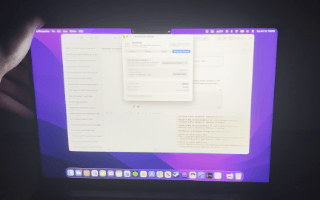

# 🪟 GlassBook (LidPerspective)

> **Real-time 3D hardware-accelerated perspective illusions and StandBy display driven by your MacBook's lid hinge sensor and head tracking, inspired by iPhone Duo.**

Press 'C' with the settings window open to calibrate/tweak settings to your preferences.


[](https://www.apple.com/macos/)
[-orange?style=flat)](https://www.apple.com/mac/)
[](https://developer.apple.com/swift/)
[](https://developer.apple.com/metal/)

---



## Overview

**GlassBook** transforms your MacBook display into an interactive optical illusion. 

By tapping into Apple Silicon's undocumented internal lid angle sensor (`IOHID`) and FaceTime HD camera via Apple's Vision framework, GlassBook detects the exact tilt of your screen and position of your face in real time. Whenever you tilt your laptop lid below 90°, your active desktop instantly transforms into a realistic 3D perspective window rendered via Metal at up to **120 FPS (ProMotion)**.

Tilt your screen down, and your desktop appears as if it's an angled sheet of glass suspended in 3D space, complete with physically modeled MacBook keyboard reflections, frosted glass diffusion, depth blur, and adaptive head parallax (optional)

---

## Key Features

### Real-Time Hardware Hinge Sensing
- **Direct IOHID Integration**: Interacts directly with Apple's internal lid sensor (`kIOHIDDeviceUsagePageKey: 0x0020`, `kIOHIDDeviceUsageKey: 0x008A`).
- **Predictive Lookahead & Dead-Reckoning**: Uses a 140ms ring buffer to calculate angular velocity and extrapolate forward tilt, eliminating lag and stutter during fast movement.
- **Velocity Thresholds**: Automatically arms when moving downward past 90° and smoothly disengages when opened.

### Custom Metal 3D Shader Pipeline
- **120Hz ProMotion Rendering**: Native zero-flicker rendering synchronized to display refresh rates using `MTKView`.
- **Wide Gamut Display P3 Color**: Maintains exact color fidelity without sRGB gamut compression.
- **Keystone & Low-Angle Compensation**: Dynamically counters perspective compression and optical distortion as the angle flattens.

### Physically Modeled 1:1 Keyboard Reflection
- **MacBook / Magic Keyboard Mapping**: Accurate 6-row procedural layout matching the MacBook keycaps (Escape, Function row, Touch ID sensor, Spacebar, Command keys, and homing bumps).
- **Fresnel & Backlight Luminescence**: Simulates specular keycap reflections, backlighting spill, and an optical depth-of-field gradient across rows.

### Head Tracking & Parallax Illusion
- **Vision-Powered Head Tracking**: Uses `VNDetectFaceRectanglesRequest` to track head coordinates ($X$, $Y$, and distance $Z$).
- **Privacy-First "Snapshot on Close" Mode**: Snaps face coordinates once at the moment the lid starts closing, then powers down the camera immediately—preserving battery and privacy.
- **Continuous Live Mode**: Actively shifts the perspective frustum in real time as you lean side-to-side or move closer.

### StandBy Clock & Calendar Mode
- **Ambient Desk Clock**: When you pause your lid stationary below 90°, the desktop dims into an ambient 3D perspective clock.
- **Dual Display Modes**:
  - **Apple StandBy Style**: Split calendar (monthly grid + day/date) with a squircle analog clock.
  - **Digital Clock**: Large typographic time projection.
- **Customizable**: Configurable positions (Top, Center, Bottom) and sizes.

### Auto-Return to Desktop
- **Smart Settle Delay**: Set a timer (0.5s to 3.0s, or Off) that smoothly unwarps and fades back to an interactive desktop when lid movement stops.

### Interactive Calibrator HUD
- Press <kbd>C</kbd> at any time to open the live Calibration HUD directly on the 3D surface. Adjust parameters, reflections, and shaders on the fly using arrow keys.

---

## Shortcuts & Controls

When the 3D perspective overlay or Settings window is active:

| Key | Action | Description |
| :--- | :--- | :--- |
| <kbd>C</kbd> | **Toggle Calibrator HUD** | Opens / closes on-screen calibration controls |
| <kbd>↑</kbd> / <kbd>↓</kbd> | **Navigate Settings** | Selects previous / next parameter in the Calibrator HUD |
| <kbd>←</kbd> / <kbd>→</kbd> | **Adjust Value** | Decreases / increases the selected parameter |
| <kbd>T</kbd> | **Toggle StandBy Clock** | Manually triggers or dismisses the perspective clock |
| <kbd>F</kbd> | **Toggle Frosted Glass** | Toggles the acid-etched frosted glass diffusion effect |
| <kbd>K</kbd> | **Toggle Keyboard Reflection** | Toggles the simulated keyboard reflection |
| <kbd>M</kbd> | **Cycle Head Tracking Mode** | Swaps between Snapshot, Continuous, and Disabled |
| <kbd>R</kbd> | **Reset Parameters** | Resets all HUD shader parameters back to defaults |
| <kbd>ESC</kbd> | **Exit Perspective** | Instantly dismisses the overlay and returns to desktop |

---

## System Architecture

```text
┌────────────────────────────────────────────────────────┐
│                      macOS System                      │
└───────────────────────────┬────────────────────────────┘
                            │
            ┌───────────────┴───────────────┐
            ▼                               ▼
   [ IOKit / IOHID ]              [ AVFoundation + Vision ]
   Lid Angle & Velocity           Face Rectangles (X, Y, Z)
            │                               │
            ▼                               ▼
     ( LidSensor )                   ( HeadTracker )
            │                               │
            └───────────────┬───────────────┘
                            │
                            ▼
              ( AutoPerspectiveManager )
               Lid state machine & triggers
                            │
                            ▼
              ( ScreenCaptureManager )
            High-speed ScreenCaptureKit
                            │
                            ▼
            ( FullscreenOverlayController )
                            │
                            ▼
               [ Metal Rendering Engine ]
        • Shaders.metal (Vertex + Fragment)
        • Keystone & Aspect Compensations
        • Procedural Magic Keyboard Specular
        • Frosted Glass & Contact Shadowing
        • StandBy Clock / Calendar Generator
